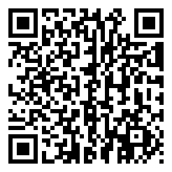

# baba3ds

Unofficial 3DS engine for Baba Is You. It runs the game's own scripts and levels from **your own copy**
of the game (the Mac Steam version); this repository contains no game files.

Not affiliated with or endorsed by Hempuli Oy. Baba Is You is © Hempuli Oy; please buy the game.

## Install
Scan this with **FBI → Remote Install → Scan QR Code** to install the latest release
([baba3ds.cia](https://github.com/AndrewMarcondes/BabaIs3ds/releases/latest/download/baba3ds.cia)):

Then set up the game data on your SD card as described under **Run** below. Step one is all that is needed. 

## Build
Needs devkitPro with `3ds-dev 3ds-zlib 3ds-libvorbisidec`.

    make

## Install over Wi-Fi while developing
`tools/serve_cia.sh` shares your freshly built `baba3ds.cia` on your network (only that file, only while
it runs) and prints a QR code to scan with FBI's Remote Install.

## Making a release
`main` holds builds tested on real hardware; new work goes on a branch until tested. To release:
1. Set `VERSION` in the Makefile, `tools/make_cia.sh` on tested `main`, then on GitHub: Releases → Draft a new
   release → tag `v<VERSION>`.
2. Attach `baba3ds.cia` and `baba3ds.3dsx` with exactly those names (the QR code links to
   `releases/latest/download/baba3ds.cia`). Never attach game data.

## Installable .cia (HOME Menu icon)
Needs [makerom](https://github.com/3DSGuy/Project_CTR/releases) and
[bannertool](https://github.com/diasurgical/bannertool) (no macOS release: compile `source/*.cpp source/pc/*.c
source/3ds/*.cpp` with clang++). Then:

    MAKEROM=/path/to/makerom BANNERTOOL=/path/to/bannertool tools/make_cia.sh

Copy `baba3ds.cia` to the SD card and install it with FBI. The icon, banner and chime are original
(`tools/make_art.py` draws them into `meta/`); the package settings are in `meta/cia.rsf`.
The game data still goes on the SD card as below, for the .cia and the .3dsx alike.

## Run
1. Prepare the game data from your own copy (Python 3, no extra packages). With the SD card mounted:

       python3 tools/prepare_sd.py "<...>/Baba Is You.app" "/Volumes/<SD card>/3ds/baba"

   On a Steam install the app is at `~/Library/Application Support/Steam/steamapps/common/Baba Is You/Baba Is You.app`.
   Add `--small-audio` (needs `brew install vorbis-tools`) to re-encode music and sound effects smaller:
   ~100 MB -> ~60 MB in total, and less work for the 3DS to decode.
   This copies the game's data, packs the ~4,400 sprite files into one `sprites.pak` (much faster and smaller on an
   SD card) and extracts the sound effects. Nothing from the game is in this repository; the tool only rearranges
   files you already own. (Copying `Data` by hand to `sdmc:/3ds/baba/Data` also works, just slower and without
   sound effects.)
2. Copy `baba3ds.3dsx` to `sdmc:/3ds/` and launch from the Homebrew Launcher.
3. For music and sound, the console's DSP firmware must be at `sdmc:/3ds/dspfirm.cdc` (Luma3DS: Rosalina menu →
   Miscellaneous options → Dump DSP firmware). Azahar needs the same file in its `sdmc/3ds/` folder.

## Level packs and mods
The title screen has **Start game** (the main game), **Level packs & mods** and **Exit**.
- Every folder in `Data/Worlds` with a `world_data.txt` is a level pack. Your copy of the game already has
  *New Adventures* and the *Museum*.
- Mods use the PC game's own format: a pack's `Lua/*.lua` files are loaded when it's played, and
  `Data/Lua/*.lua` mods always. A pack can bring its own `Sprites/`, `Music/` and `Palettes/` too.
- To add a community pack or mod made for the PC version, copy its folder into `sdmc:/3ds/baba/Data/Worlds/`
  (and re-run `prepare_sd.py` if you keep packs on your Mac, so its sprites get packed).

## Controls
D-pad/Circle Pad move, B undo, A wait (in a level) / enter level (on the map), X restart, SELECT back to map,
START pause menu (resume, restart, return to map, title screen, quit).
In Azahar (default keys): arrows move, S undo, A wait/enter, Z restart, N back to map, M menu.
Progress is saved to `sdmc:/3ds/baba/save.ini`.

## Host tests (Mac/Linux, need zlib)

    test/build_host.sh
    test/level_test.sh <path to Data>        # C level parser vs Python on every level
    build-host/script_test <path to Data>    # runs test/play_test.lua: level 1, win, map, enter level 2, leave
    build-host/script_test <path to Data> test/sweep_test.lua     # loads and plays a few turns of every level
    build-host/script_test <path to Data> test/progress_test.lua  # gates and map clears
    build-host/script_test <path to Data> test/convert_test.lua   # things that transformed can transform again
    build-host/script_test <path to Data> test/tick_test.lua      # animation ticks report every change to the picture
    build-host/script_test <path to Data> test/speedups_test.lua    # the shim's faster game functions play every level the same
    build-host/script_test <path to Data> test/bench_test.lua       # the pause menu benchmark leaves the game and save as they were
    build-host/render_test <path to Data> out.ppm [save.ini] [keys...] ["=100level"]  # boot with a save, play keys or jump to a level, render

Emulator screenshot (Azahar running with RPC server enabled; copy AzaharRPC.py from Azahar's scripting/ folder into tools/):

    python3 tools/emu_shot.py build-host/emu

Lua 5.3.4 is vendored in `lua/` (MIT, see lua/LICENSE).

Reverse-engineering notes: NOTES.md.

## License
MIT (see LICENSE) for this project's code and art; Lua 5.3.4 in `lua/` is MIT too (`lua/LICENSE`).
Baba Is You itself is not included and not covered.
